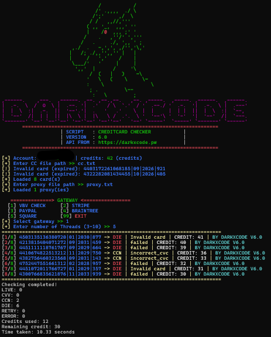

## CVV-CHECKERV6.0.1

The CVV Validation with luhn algoritm and 6 gateway.

<h1 align="center">
   
  
   
  CVV VALIDATION // LUHN ALGORITM
   
</h1>

  
  

 • <a href="https://darkxcode.pw/docs/api#cc-checker">API Docs</a> •
  <a href="https://darkxcode.pw">Demo</a> •
  <a href="https://darkxcode.site/">Other Tools</a> •

## Output

This is the result if the code is successfully validation.

---

> **NOTE**
> Warning All the information provided here is intended solely for educational and testing purposes.
> I do not endorse any illegal activities or unfair usage of this program.
